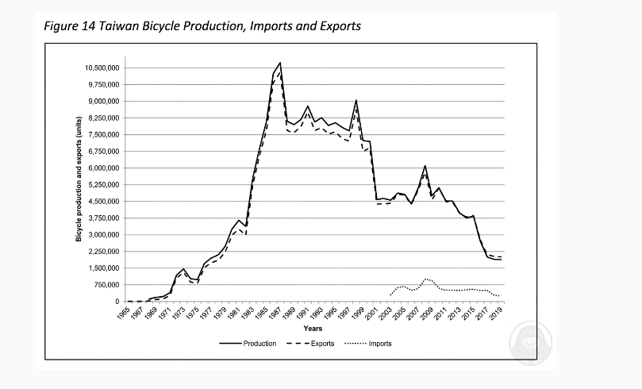

# Taiwan Bicycle Production, Imports and Exports（2026-10-14）

图：三条线，1965～2019 年。生产（实线）和出口（虚线）几乎重合：1965 年接近 0，1987 年左右到顶峰约 1,050 万辆，1998 年有第二个高点约 900 万，2001 年跌到约 460 万，2008 年小高点约 600 万，2019 年降到约 200 万。进口（点线）2002 年后才出现，一直低于 100 万，2019 年约 25 万。

**参考答案（约 85 词，正常语速约 37 秒）**

> This line graph shows Taiwan's bicycle production, exports and imports from 1965 to 2019. Production rose sharply from almost zero and peaked at about 10.5 million units around 1987. After that, it fluctuated and declined, with a second peak of around 9 million in 1998, and fell to about 2 million by 2019. Exports followed almost exactly the same trend as production. In contrast, imports only appeared after 2002 and stayed below 1 million. Overall, most bicycles made in Taiwan were exported.

**这张图的要点**

- 三条线不用平均分配时间：主线（生产）讲最多，出口一句话 "followed almost exactly the same trend" 带过，进口一句话讲"出现晚、数量小"。
- 只讲关键点：起点、最高点、第二高点、终点，中间小波动用 fluctuated 概括。
- 大数字读法：10,500,000 读 ten point five million；纵轴单位是 units，说一次就够。
- 年份看不准时用 around / about，不要卡在读刻度上。
- 结论要从图里推出来：生产和出口几乎重合，所以 most bicycles were exported。

模板见 [模板.md](模板.md)。
