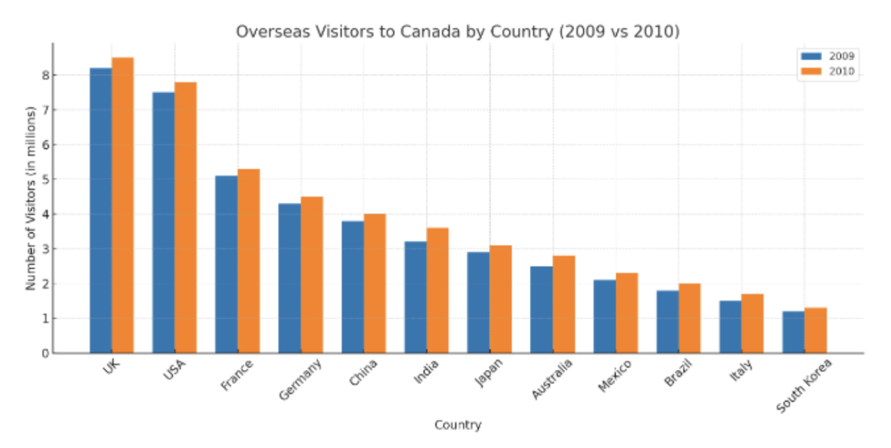

# #1254 Overseas Visitors（2026-10-18）

图：分组柱状图，12 个国家去加拿大的游客人数，蓝色 2009、橙色 2010，纵轴单位是百万（millions）。英国最高（约 8.2 → 8.5 百万），美国第二（约 7.5 → 7.8），法国约 5.1 → 5.3，韩国最低（约 1.2 → 1.3）。每个国家 2010 年都比 2009 年略高。

**参考答案（约 75 词，正常语速约 33 秒）**

> This bar chart compares the number of overseas visitors to Canada from twelve countries in 2009 and 2010, in millions. The UK has the highest number, at about 8.2 million in 2009 and 8.5 million in 2010. The USA comes second, with around 7.5 and 7.8 million. In contrast, South Korea has the lowest, at only about 1.2 million. Overall, the number of visitors from every country increased slightly in 2010.

**这张图的要点**

- 12 个国家不用全念，按模板只说最高（UK）、第二（USA）、最低（South Korea）。
- 两种颜色是两个年份：第一句就点出 2009 and 2010，最后一句用"每个国家 2010 年都略有增加"做总结，这就是双色柱状图的趋势句。
- 纵轴单位是 millions，第一句说一次，后面数字直接说 million。
- 8.2 读 eight point two；数字看不准就用 about / around。

模板见 [模板.md](模板.md)。
