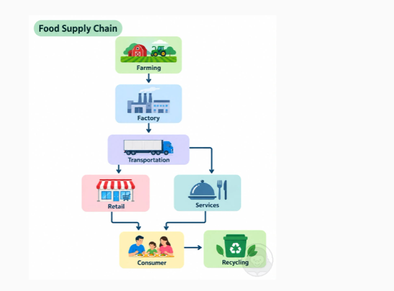

# Food Supply Chain（2026-10-14）

图：Farming → Factory → Transportation → 分成 Retail 和 Services 两支 → Consumer → Recycling。

**参考答案（约 75 词，正常语速约 35 秒）**

> This flowchart shows the food supply chain, which consists of six main stages. It begins with farming. The products are then processed in factories and delivered by transportation. After that, the chain splits into two branches: retail stores and food services, such as restaurants. Both branches lead to consumers, who buy and eat the food. Finally, the waste goes to recycling. Overall, the diagram shows how food moves step by step from farms to our tables.

**这张图的要点**

- 流程图没有数字，内容分靠**把每个标签都说出来**（六个框一个不漏）和**说清顺序**。
- 顺序词轮着用：begins with → then → after that → finally。
- 分叉处是亮点：the chain splits into two branches，再用 both branches lead to 合回来。
- 结尾一句总结整个过程，不要说 "this image is very informative"。

模板见 [模板.md](模板.md)。
