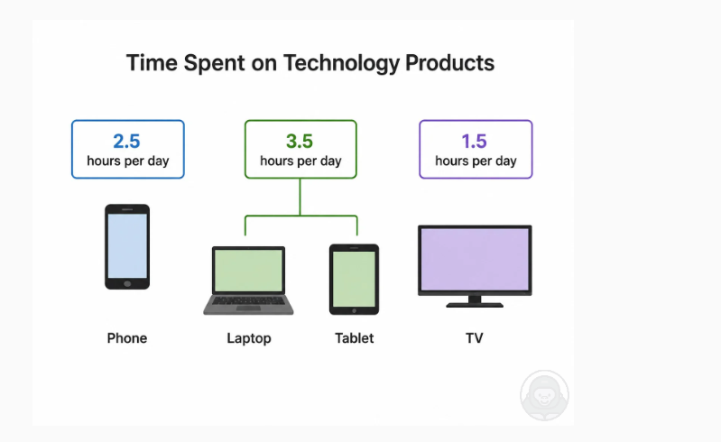

# Time Spent on Technology Products（2026-10-19）

图：图标 + 数字的示意图，4 种设备每天使用时间。Phone 2.5 小时，Laptop 和 Tablet 连到同一个框，合计 3.5 小时，TV 1.5 小时。单位是 hours per day。

**参考答案（模板 A）**

> This picture shows the time spent on technology products. The highest is laptops and tablets together, at about 3.5 hours per day. The lowest is TV, at about 1.5 hours per day. Phones are about 2.5 hours, which is higher than TV. Overall, people spend much more time on laptops and tablets than on TV.

**这张图的要点**

- 有数字，所以用模板 A（和柱状图一样的五句），不要按前景、背景说。
- Laptop 和 Tablet 共用一个 3.5 的框，要说 laptops and tablets **together**。
- 2.5 读 two point five，3.5 读 three point five。

模板见 [模板.md](模板.md)。
